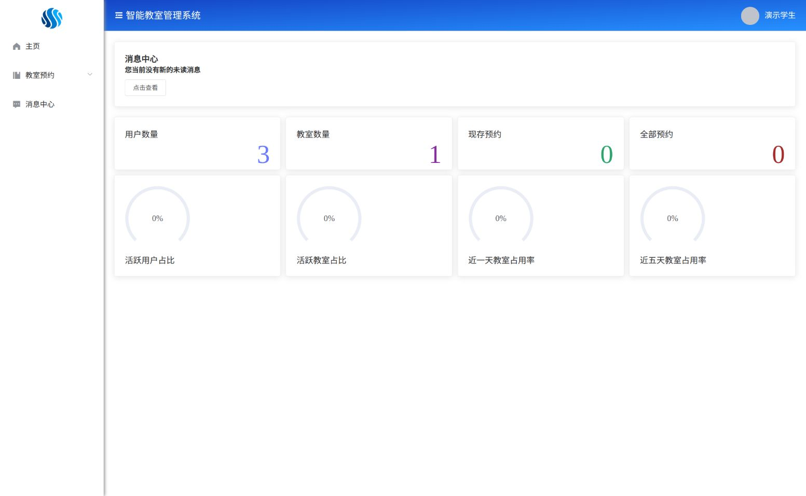

# 蓝星智能教室 · 前端

本科毕业设计“智能教室管理系统”的网页客户端，保留手写 Vue 页面和角色布局，并整理为可复现构建、可配置 API 的版本。

[后端仓库与启动说明](https://github.com/wangmancang520/GraduationProject) · [原始前端](https://github.com/Kaolennoodle/GraduationProjectWeb)

## 界面预览



## 已实现功能

- 学生 / 教职工：注册登录、教室查询、创建及修改预约、查看自己的预约与通知。
- 教室管理员：查看与维护管理的教室，处理预约审核，查看通知。
- 系统管理员：管理用户、教室和预约，查看数量、活跃占比及利用率。
- 通用功能：个人资料、头像上传、修改密码、退出登录、登录过期处理。

设备状态 / 控制和部分系统设置属于原毕业设计预留页面，尚未接入硬件。当前版本不宣称已实现物联网设备控制。

## 技术栈

Vue 2.7.16、Vue Router 3.6.5、Element UI 2.15.14、Axios 1.x、Vite 7。页面沿用 Options API 与原设计，没有将历史项目整体改写为 Vue 3。

构建迁移使用 [Vue 2.7 官方迁移说明](https://v2.vuejs.org/v2/guide/migration-vue-2-7)支持的 `@vitejs/plugin-vue2`。Vue 2 与 Element UI 是历史技术栈，长期维护建议继续迁移到 Vue 3。

## 本地启动

准备 Node.js 22.12+（22.x）和 npm，先启动配套后端：

```bash
# 后端所在目录
mvn spring-boot:run -Dspring-boot.run.profiles=demo
```

然后启动前端：

```bash
git clone https://github.com/wangmancang520/GraduationProjectWeb.git
cd GraduationProjectWeb
npm ci
npm run dev
```

打开 `http://localhost:8080`。默认 `/api` 请求由 Vite 代理到 `http://localhost:8081`，无需额外配置跨域。

演示模式账号（统一密码 `Demo12345`）：

| 登录名 | 角色 |
| --- | --- |
| manager@example.com | 系统管理员 |
| teacher@example.com | 教室管理员 |
| student@example.com | 学生 |

演示账号仅适用于本地 H2 演示，数据随后端进程重启清空。完整容器演示见[后端 Docker Compose 说明](https://github.com/wangmancang520/GraduationProject#readme)。

## 配置后端地址

按需复制 `.env.example` 为 `.env.local`：

```dotenv
VITE_API_BASE_URL=/api
API_PROXY_TARGET=http://localhost:8081
```

| 变量 | 作用 |
| --- | --- |
| VITE_API_BASE_URL | 编译进浏览器代码的 API 前缀，默认 `/api` |
| API_PROXY_TARGET | 仅开发代理使用的后端地址，默认 `http://localhost:8081` |

Vite 修改环境变量后需要重启。生产环境应使用 Nginx 等代理 `/api/`；`API_PROXY_TARGET` 不会改变已构建网页。不要把密钥放进 `VITE_*` 变量。

路由使用 history 模式，服务器必须把非 API 的前端路径回退到 `index.html`。仓库提供的 `deploy/nginx.conf` 包含 history 回退和 `/api/` 代理，默认后端服务名为 `backend:8081`。部署到其他环境时相应修改上游地址。

头像接口返回的文件地址由后端 `FILE_PUBLIC_URL` 决定。同域部署建议设置为 `/api/file`。

## 构建与验证

```bash
npm test         # 会话、角色与预约时区转换
npm run build    # 产物位于 dist/
npm run preview  # 检查静态构建；不提供开发 API 代理
npm audit        # 查看当前依赖风险
```

使用锁文件配合 `npm ci` 安装。GitHub Actions 自动运行安装、测试与生产构建。本轮依赖审计快照从原有 78 项风险降到 3 项低风险；依赖公告会变化，请以实际 `npm audit` 为准。仍存在 Vue 2 / Element UI 相关遗留依赖风险，不能据此认为适合直接面向公网生产运行。

## 项目结构

```text
src/
  views/          登录、注册与三类角色布局
  components/
    Manager/      系统管理员页面
    ClassroomAdmin/ 教室管理员页面
    User/         普通用户页面
  router/         路由与角色入口保护
  utils/          Axios 客户端、会话读取与日期工具
  assets/         原项目图片和样式
tests/            Node 内置测试运行器
deploy/           Nginx 配置
vite.config.mjs   开发代理与构建配置
```

## 本轮整理

- 使用 Vite 替换旧 Vue CLI / Webpack，精简依赖，保留原有业务组件。
- 通过 `.gitignore` 排除 `node_modules`、构建产物和本地环境文件。
- API 请求与头像上传统一使用可配置前缀，移除散落的 localhost 地址。
- 处理损坏的本地会话、登录过期、网络错误和角色路由访问。
- 修复预约列表的分页结构；预约创建、编辑和审核改为 POST。
- 日期与时间按 `Asia/Shanghai` 校园时区发送和显示，避免浏览器时区导致预约日期偏移。
- 头像上传携带登录凭证；密码修改成功后清除本地登录信息。

后端必须独立校验权限；浏览器中的角色和路由保护不能当作安全边界。登录凭证保留原项目的 localStorage 方案；生产化时还需评估 XSS 防护、令牌存储与会话管理。

## 项目来源

原作者账号：[Kaolennoodle](https://github.com/Kaolennoodle)。整理基线：`6e7d061a0c60649c0284fa48292994eaf09940b5`。

保留原项目源码与素材来源，在新账号发布清理后的快照；旧仓库提供原始提交历史。未新增原仓库没有的许可证，使用或分发前请确认授权。
